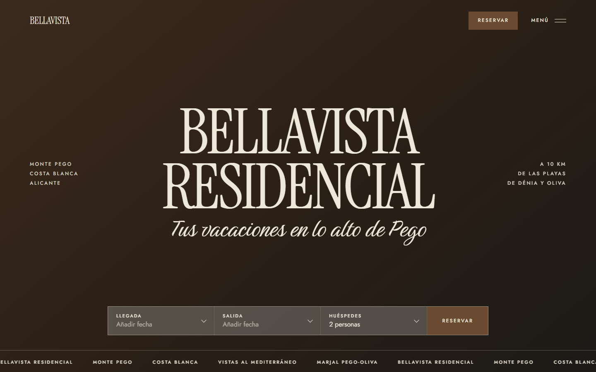

# Bellavista Residencial

Rediseño de la web de unos apartamentos turísticos en Monte Pego (Costa Blanca), con tono cálido y editorial.

- **Estado:** demo
- **Fecha:** 2026-11
- **Stack:** HTML/CSS/JS, sin build
- **Fuentes:** Instrument Serif (títulos), Birthstone (firma manuscrita), Jost (texto)
- **Paleta:** `#1C1A17` tinta, `#3B2A1E` marrón oscuro, `#6B4A32` marrón, `#DAD4C4` lino, `#EDE8DA` crema
- **Páginas:** index, apartamentos, apartamento (ficha), instalaciones (servicios), alrededores, galería, reservar, contacto
- **Decisiones:** negro cálido y marrones en vez de azules de playa para diferenciarse; títulos en versalitas de serif y una firma manuscrita como contrapunto; menú a pantalla completa sin JS (checkbox).
- **Cómo verla:** abrir `index.html`. Los formularios son simulados y no envían nada.

